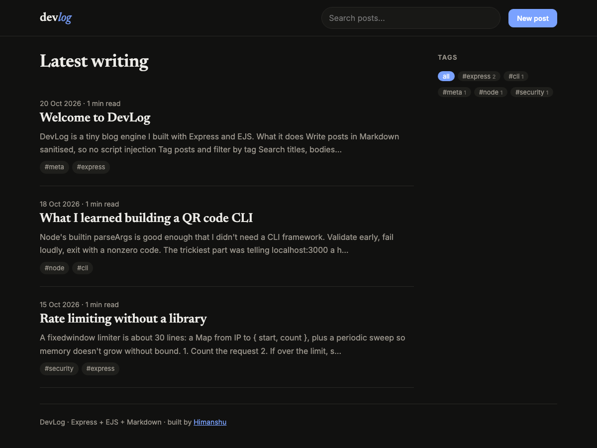

# 📝 DevLog

> A Markdown blog engine built with **Express + EJS**. It has full CRUD, tags, search, reading time, sanitised HTML output, atomic JSON-file persistence and optional admin auth for public deploys.

**🔗 Live demo:** https://devlog-fhwp.onrender.com/ *(free tier: the first visit after idle takes ~30–60s to wake up)*

[](https://github.com/himanshuuem/devlog/actions/workflows/test.yml)




## ✨ Features

- **Create, read, update, delete:** HTML forms with POST-redirect-GET, a `303` after every write and a delete confirmation.
- **Markdown posts** rendered with `marked`, then **sanitised** with `sanitize-html`. Script tags and `javascript:` links are stripped, which the tests verify.
- **Tags** are normalised (`"Express JS"` becomes `express-js`) and filterable, with a tag cloud that shows counts.
- **Search** across titles, bodies and tags.
- **Validation** with field-level errors, `aria-invalid` and `aria-describedby`, a **422** re-render that keeps your input, and length limits.
- **Persistence without a database:** a small repository class writes JSON to a temp file and `rename`s it into place (atomic), with writes serialised through a promise chain.
- **Optional admin auth:** set `ADMIN_PASSWORD` and the write routes require HTTP Basic auth (compared in constant time). Reading stays public.
- An editorial layout with Newsreader and Inter, automatic dark mode, a sticky search bar and reading-time estimates.

## 🚀 Run Locally

```bash
git clone https://github.com/himanshuuem/devlog.git
cd devlog
npm install
npm run dev     # http://localhost:3000 (seeded with 3 posts)
npm test        # unit + full CRUD integration tests
```

## ☁️ Deploy (free)

`render.yaml` is included. Create a Blueprint on [Render](https://render.com) and set `ADMIN_PASSWORD`. The free tier's disk is ephemeral, so posts reset on redeploy. That's fine for a demo, and you can point `DATA_FILE` at a persistent disk for real use.

## 📁 Structure

```
devlog/
├── src/
│   ├── server.js      # Boot: load store, start app
│   ├── app.js         # Routes, view locals, error handling
│   ├── store.js       # PostStore: atomic JSON persistence
│   ├── posts.js       # Validation, Markdown rendering, excerpts
│   ├── adminAuth.js   # Optional Basic auth middleware
│   └── seed.js        # Starter posts
├── views/             # index, post, form, 404 + partials
├── public/            # styles.css, confirm.js
└── test/app.test.js
```

## 📚 Origin

This is my build of **Capstone 2: Blog Web Application** from [The Complete Web Development Bootcamp](https://www.udemy.com/course/the-complete-web-development-bootcamp/). It goes beyond the in-memory array with Markdown, sanitisation, persistence, search and tests.

---

Made by [Himanshu](https://github.com/himanshuuem)
